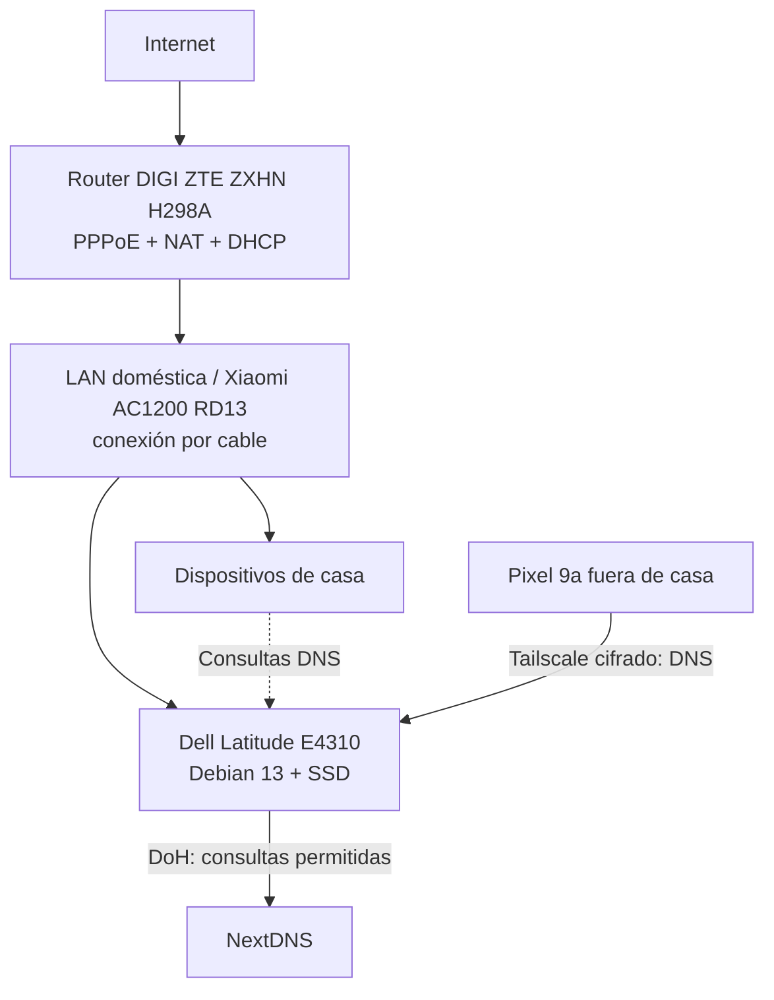

# Debian Security Homelab

> Proyecto personal de laboratorio de redes, DNS, privacidad y seguridad con un portátil reutilizado.
>
> **Origen:** nació al investigar las conexiones del Xiaomi Mesh, los límites del filtrado DNS y cómo centralizar NextDNS tras pasar el AP a modo puente. [Historia y decisiones iniciales](docs/11-origen-del-proyecto.md).
>
> **Última revisión de la documentación:** 2026-10-19. **Estado:** operativo para DNS y acceso VPN; la función Exit Node queda pendiente de diagnóstico.

## Objetivos

Esta documentación se publica sin IPs concretas, identificadores de servicios, credenciales ni registros DNS. El repositorio es **público**, por lo que las configuraciones reales se mantienen fuera de GitHub.

- Reutilizar un equipo antiguo, minimizando consumo eléctrico y compras.
- Proteger la resolución DNS doméstica con AdGuard Home y NextDNS.
- Utilizar los filtros DNS fuera de casa mediante Tailscale, incluso con CG-NAT.
- Aprender Debian, redes, routing, hardening, observabilidad y troubleshooting.
- Mantener la conexión doméstica disponible mientras se experimenta.

## Arquitectura actual (confirmada parcialmente)



**Importante:** el Dell **no es** el firewall perimetral de casa. El ZTE sigue gestionando NAT y DHCP. AdGuard protege las consultas DNS que llegan a él, no todo el tráfico IP.

## Inventario de progreso

| Elemento | Estado | Evidencia / matiz |
| --- | --- | --- |
| Debian 13 minimal | **Confirmado** | Arranca y ejecuta servicios en el Dell |
| SSD + 8 GB RAM + i5 M560 | **Confirmado** | Diagnóstico local por terminal |
| Conexión Ethernet | **Confirmado** | Interfaz `eno1` conectada a la LAN |
| Optimización de pantalla | **Confirmado parcialmente** | Pantalla queda negra sin resplandor y lo mantiene tras reinicio; vatios sin medir |
| Radio Wi-Fi/Bluetooth bloqueada | **Confirmado** | `rfkill` mostró `Soft blocked: yes` después de reiniciar |
| Suspensión systemd enmascarada | **Confirmado** | `sleep`, `suspend` e `hibernate` figuraban `masked` |
| AdGuard Home | **Confirmado** | Servicio activo, puerto 53 TCP/UDP, consultas de equipos LAN |
| NextDNS por HTTPS | **Confirmado en configuración** | Proveedor HTTPS configurado; estadísticas mostraron consultas por él |
| Filtros | **Confirmado** | AdGuard DNS Filter y HaGeZi TIF Mini activados |
| Reserva DHCP para el Dell | **Confirmado por usuario** | Configurada en ZTE |
| Tailscale entre Dell y Pixel | **Confirmado** | Ambos aparecían en `tailscale status` |
| DNS del Pixel vía Tailscale | **Confirmado** | AdGuard registró consultas desde el móvil |
| Tailscale Exit Node | **No resuelto** | Se intentó activar; hubo problemas con Spotify; no se ha acreditado una solución |
| nftables endurecido / OpenWrt virtual | **Pendiente** | Solo diseño; no confundir con implementación |

## Documentación

- [11 · Origen: Xiaomi Mesh, NextDNS y decisión de reutilizar hardware](docs/11-origen-del-proyecto.md)
- [00 · Arquitectura y flujos](docs/00-arquitectura.md)
- [01 · Hardware, consumo y estado térmico](docs/01-hardware-consumo.md)
- [02 · Debian y configuración base](docs/02-debian-base.md)
- [03 · AdGuard Home + NextDNS](docs/03-adguard-nextdns.md)
- [04 · Tailscale y DNS remoto](docs/04-tailscale-dns.md)
- [05 · Exit Node: diagnóstico pendiente](docs/05-exit-node-incidencia.md)
- [06 · Modelo de seguridad y firewall futuro](docs/06-seguridad-firewall.md)
- [07 · Operaciones, respaldos y recuperación](docs/07-operaciones-runbook.md)
- [08 · Hoja de ruta](docs/08-roadmap.md)
- [09 · Incidencias y lecciones](docs/09-incidencias.md)
- [Seguridad de publicación y mantenimiento de GitHub](docs/10-publicacion-github.md)

## Comprobación rápida (desde el propio Dell)

```bash
systemctl is-active AdGuardHome
systemctl is-active tailscaled
tailscale status
ss -lntup | grep ':53'
dig @127.0.0.1 example.com A +time=2 +tries=1
```

Opcional: `bash scripts/healthcheck.sh` realiza pruebas locales de solo lectura; no actualiza paquetes ni cambia reglas.

## Reglas de seguridad del repositorio

Este material está **anonimizado**. No introducir valores reales de IP pública, perfil NextDNS, claves de WireGuard/Tailscale, URLs de login, contraseñas, archivos `AdGuardHome.yaml` completos, `auth keys`, capturas de administración ni configuraciones Fortinet corporativas.

Si se publica como repositorio abierto, volver a revisar el historial de commits: borrar un secreto del archivo actual **no** lo borra de commits anteriores.

## Referencias oficiales

- [Debian](https://www.debian.org/)
- [AdGuard Home](https://github.com/AdguardTeam/AdGuardHome)
- [Tailscale: DNS](https://tailscale.com/kb/1054/dns)
- [Tailscale: Exit Nodes](https://tailscale.com/kb/1103/exit-nodes)
- [nftables Wiki](https://wiki.nftables.org/)

> Documentación basada en comandos y resultados compartidos durante el montaje. Los campos no comprobados están identificados explícitamente; no representa una auditoría independiente.