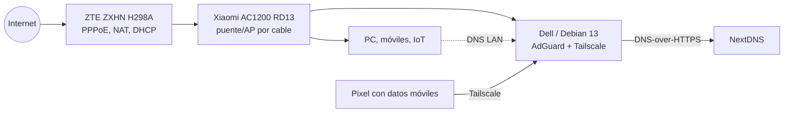
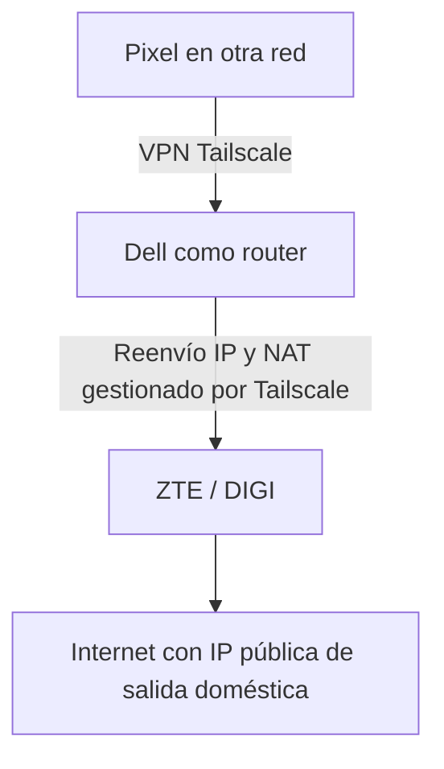

# 00 · Arquitectura y flujos de red

## Topología física y lógica

El Dell dispone de una interfaz Ethernet física (`eno1`). Está conectado como **servidor dentro de la LAN**, no entre WAN y LAN. No se ha desplegado OPNsense/OpenWrt como firewall físico.

## Flujo 1: DNS dentro de casa

1. El ZTE entrega configuración IP mediante DHCP.
2. Configuración indicada para DHCP: DNS preferido = IP LAN del Dell; DNS secundario = IPv4 de NextDNS vinculada al perfil.
3. Un cliente consulta AdGuard si escoge el DNS del Dell.
4. AdGuard responde con caché, bloquea según filtros o consulta a NextDNS mediante DNS-over-HTTPS.

**Limitación importante:** los clientes pueden utilizar el DNS secundario incluso con el primario disponible. Por tanto, no es correcto afirmar que todas las consultas LAN pasan por AdGuard. Además, las consultas a NextDNS realizadas directamente por IPv4 tradicional no están cifradas.

## Flujo 2: DNS desde el móvil fuera de casa

1. Tailscale conecta el Pixel y el Dell por un túnel cifrado.
2. La administración DNS de Tailscale anuncia la IP virtual del Dell como nameserver global.
3. El Pixel, con **Use Tailscale DNS** activado, envía consultas al puerto 53 del Dell.
4. AdGuard aplica filtros y reenvía a NextDNS por HTTPS.

Esta ruta DNS **no exige** que el Dell actúe como Exit Node. Tampoco enruta todo el tráfico web a casa.

## Flujo 3: Exit Node (experimental, NO confirmado como funcional)

Solo cuando el Pixel selecciona el Dell como Exit Node. Se observaron fallos de Spotify durante este experimento; falta separar posibles problemas de routing, DNS y conectividad. **No documentar como producción.**

## Direccionamiento (plantilla sin secretos)

| Componente | Dirección |
| --- | --- |
| Router doméstico | `<ROUTER_LAN_IP>` |
| Dell, Ethernet | `<DELL_LAN_IP>` |
| Dell, Tailscale | `<DELL_TAILSCALE_IP>` |
| Pixel, Tailscale | `<PIXEL_TAILSCALE_IP>` |
| NextDNS configurado | `https://dns.nextdns.io/<NEXTDNS_PROFILE_ID>` |

Las direcciones reales se guardan **fuera del repositorio**. Las IP LAN y de tailnet son privadas, pero igualmente conviene no divulgarlas innecesariamente.

## CG-NAT e IPv6

- La WAN del ZTE estaba dentro de `100.64.0.0/10` y no coincidía con la IPv4 pública de salida: **CG-NAT confirmado**.
- El estado WAN mostraba GUA `::` y prefijo `None`: **no se observó prefijo IPv6 global usable en esa pantalla**, aunque esto no sustituye una auditoría completa de IPv6.
- Anteriormente Windows recibió `fe80::1` como DNS IPv6 desde el router. **Queda pendiente** revisar si el anuncio IPv6 permite evitar AdGuard.
- Durante pruebas se observó una VPN corporativa Fortinet que añadía resolutores propios a Windows. No modificar DNS corporativos ni realizar pruebas invasivas con esa VPN activa.